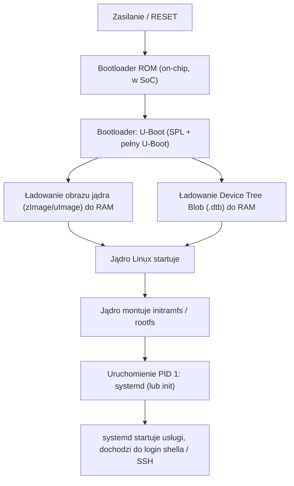

# Chapter 2: Czym jest jądro Linux i jak współgra z otoczeniem

[← Spis treści](README.md)

**Cel rozdziału:** Zbudować mentalny model tego, czym jest jądro
(kernel), jaką rolę pełni między sprzętem a programami użytkownika, i
jak te warstwy się ze sobą komunikują. To rozdział czysto koncepcyjny
z ćwiczeniami obserwacyjnymi – bez tego trudno zrozumieć sens sterowników,
modułów i device tree z dalszych rozdziałów.

Ten temat jest inny niż programowanie mikrokontrolerów: na STM32 Twój
program **jest** jedynym właścicielem procesora i wszystkich rejestrów.
W Linuksie między Twoim programem a sprzętem stoi jądro, które
**dzieli** te zasoby między wiele procesów i chroni je przed sobą
nawzajem.

---

## 1. Co robi jądro?

Jądro to program (a właściwie zbiór programów), który startuje jako
pierwszy po bootloaderze i pozostaje w pamięci przez cały czas pracy
systemu. Jego zadania:

- **Zarządzanie procesami** – kto i kiedy dostaje czas procesora
  (scheduler), tworzenie/kończenie procesów.
- **Zarządzanie pamięcią** – przydzielanie RAM procesom, pamięć
  wirtualna, ochrona pamięci jednego procesu przed innym.
- **Sterowniki urządzeń** – jedyny kod, który faktycznie "rozmawia" z
  rejestrami sprzętu (UART, I2C, SPI, USB, ekran...).
- **Systemy plików** – tłumaczenie `open("/etc/hostname")` na
  konkretne sektory na karcie SD/eMMC.
- **Sieć** – stos TCP/IP, sockety.
- **IPC** (Inter-Process Communication) – pipes, sygnały, shared
  memory – mechanizmy komunikacji między procesami.

Linux to **jądro monolityczne** – większość powyższych działa w jednym
wspólnym adresie pamięci (w przeciwieństwie do mikrojądra, gdzie
sterowniki są osobnymi procesami). Zaletą jest wydajność, wadą – błąd w
sterowniku może wywalić całe jądro (kernel panic). Kompromisem są
**moduły ładowalne** (patrz sekcja 4) – kod sterownika dociąga się
dynamicznie, ale nadal działa we wspólnej przestrzeni jądra.

---

## 2. Kernel space vs. user space

To najważniejsza koncepcja tego rozdziału. Procesor (na x86 i ARM)
wspiera różne **poziomy uprzywilejowania**. Linux używa dwóch:

| | Kernel space (ring 0) | User space (ring 3) |
|---|---|---|
| Kto tu działa | Jądro, sterowniki | Twoje programy: bash, ssh, aplikacje |
| Dostęp do sprzętu | Pełny, bezpośredni | Zabroniony – tylko przez jądro |
| Dostęp do pamięci innych procesów | Pełny | Zabroniony |
| Błąd/crash | Kernel panic (cały system pada) | Program się zamyka (`Segmentation fault`), system żyje dalej |

**Dlaczego to rozdzielenie istnieje:** ochrona i stabilność. Gdyby
Twój program mógł bezpośrednio pisać do rejestrów sprzętu albo do
pamięci innego procesu, jeden błąd w aplikacji (np. serwerze WWW)
mógłby zawiesić lub uszkodzić cały system. Na mikrokontrolerze bez MMU
(np. prosty STM32) tego rozdzielenia zwykle nie ma – stąd embedded C
developerzy często pierwszy raz świadomie stykają się z tą koncepcją
dopiero przy Linuksie.

**Jak program w user space w ogóle prosi jądro o coś (np. "otwórz mi
plik")?** Przez **wywołania systemowe (syscalls)** – jedyną oficjalną
"bramkę" między tymi światami.

---

## 3. Syscalls – jedyna oficjalna brama

Syscall to ściśle zdefiniowana funkcja, którą program user space może
wywołać, a procesor przełącza się wtedy na chwilę w tryb kernela,
wykonuje żądaną operację i wraca. Przykłady najczęściej używanych:

| Syscall | Co robi |
|---|---|
| `open()` | Otwiera plik/urządzenie, zwraca deskryptor (numer) |
| `read()` / `write()` | Czyta/zapisuje dane przez deskryptor |
| `fork()` | Tworzy nowy proces – kopię bieżącego |
| `execve()` | Podmienia obraz procesu na inny program (używane po `fork()`) |
| `ioctl()` | "Wszystko inne" – niestandardowe polecenia do sterownika |
| `mmap()` | Mapuje plik/pamięć bezpośrednio w przestrzeń adresową procesu |
| `socket()` | Tworzy gniazdo sieciowe |

Biblioteka C (`glibc` na PC, `musl` często w embedded) owija te
syscalle w wygodne funkcje – gdy w C++ wołasz `fopen()`, w środku i tak
kończy się to na syscallu `open()`.

**Podglądnij to na żywo:**
```bash
strace -c ls /
```
`strace` przechwytuje i loguje każdy syscall wykonany przez program.
Flaga `-c` daje podsumowanie: ile razy który syscall został wywołany i
ile czasu to zajęło. Zobaczysz, że nawet proste `ls` robi dziesiątki
syscalli (`openat`, `read`, `close`, `mmap`...).

```bash
strace -e trace=open,openat,read,write cat /etc/hostname
```
Tu ograniczamy śledzenie tylko do wybranych syscalli – dokładnie
widzisz kolejność: `openat("/etc/hostname")` → `read(...)` →
`write(1, ...)` (1 = stdout) → `close(...)`.

> 💡 **Praktyczne zastosowanie w Embedded Linux:** `strace` to jedno z
> pierwszych narzędzi do debugowania "dlaczego mój program na
> BeagleBone nie może otworzyć /dev/ttyO1" – zobaczysz dokładnie, na
> którym syscallu i z jakim kodem błędu (`errno`) coś się wysypuje.

---

## 4. Moduły jądra – dociąganie kodu "na żywo"

Zamiast wkompilowywać każdy możliwy sterownik na sztywno do jednego
wielkiego pliku jądra, Linux pozwala ładować/wyładowywać fragmenty kodu
jądra w locie – to **moduły** (`.ko` – kernel object).

```bash
lsmod
```
Lista aktualnie załadowanych modułów wraz z tym, ile pamięci zajmują i
przez ile innych modułów są używane.

```bash
sudo modprobe <nazwa>   # ładuje moduł (i jego zależności) po nazwie
sudo insmod plik.ko     # ładuje konkretny plik .ko bez rozwiązywania zależności
sudo rmmod <nazwa>      # wyładowuje moduł
```

Do tego wrócimy praktycznie w Etapie 3 kursu (pisanie własnego modułu
jądra i character device drivera) – tu chodzi tylko o zrozumienie, że
"sterownik" nie musi być częścią jednego wielkiego binarnego obrazu
jądra, tylko osobnym plikiem dociąganym w razie potrzeby (np. gdy
podłączysz USB-serial i jądro rozpozna urządzenie).

---

## 5. Jak to wszystko startuje – proces bootowania



Krótko:
1. **Bootloader ROM** – niewielki kod zaszyty na stałe w krzemie SoC,
   jedyne zadanie to znaleźć i uruchomić kolejny etap (np. z karty SD).
2. **U-Boot** – właściwy bootloader używany w większości płytek ARM
   (w tym BeagleBone). Potrafi wczytać obraz jądra i device tree z
   karty SD/eMMC/sieci (TFTP) do RAM i przekazać sterowanie jądru.
3. **Jądro** – od tego momentu to co opisano w sekcjach 1-4 wyżej.
4. **`systemd`** (PID 1) – pierwszy proces user space, rodzic
   wszystkich innych procesów, odpowiada za start usług (sieć, SSH,
   Twoja aplikacja).

**Podglądnij to na żywo:**
```bash
uname -a          # nazwa jądra, wersja, architektura, kiedy zbudowane
cat /proc/version # to samo w formie tekstowej z /proc

dmesg | less      # bufor kołowy logów jądra - komunikaty od momentu bootu
                  # (rozpoznane urządzenia, załadowane sterowniki, błędy)

systemctl status  # drzewo/status usług uruchomionych przez systemd
ps -p 1 -o pid,comm   # potwierdź że PID 1 to systemd (lub init)
```

**✅ Zadanie:**
1. Uruchom `strace -c ls /` – które 3 syscalle były wywołane
   najwięcej razy?
2. Na BeagleBone: `dmesg | head -50` – znajdź linię, w której jądro
   rozpoznaje Device Tree/model płytki. Wklej ją.
3. Uruchom `lsmod` na BeagleBone i na Ubuntu – porównaj liczbę
   załadowanych modułów. Który system ma ich więcej i dlaczego (jaki
   sprzęt jest obsługiwany)?
4. Sprawdź `ps -p 1 -o pid,comm` – czy to `systemd`, czy coś innego
   (niektóre minimalne obrazy embedded używają np. BusyBox init)?

**Notatki / odpowiedzi:**
```
(tu wpisz swoje wyniki)
```

---

## Podsumowanie

Po tym rozdziale powinieneś:
- [ ] Rozumieć rolę jądra jako pośrednika między sprzętem a programami
- [ ] Rozumieć różnicę kernel space vs. user space i dlaczego istnieje
- [ ] Wiedzieć czym jest syscall i umieć podejrzeć je przez `strace`
- [ ] Rozumieć ideę modułów jądra jako dociąganego w locie kodu
- [ ] Znać ogólny przebieg bootowania: ROM → U-Boot → jądro → systemd

**Następny rozdział:** [Chapter 3 – Procesy i sygnały](chapter3_processes_signals.md)
