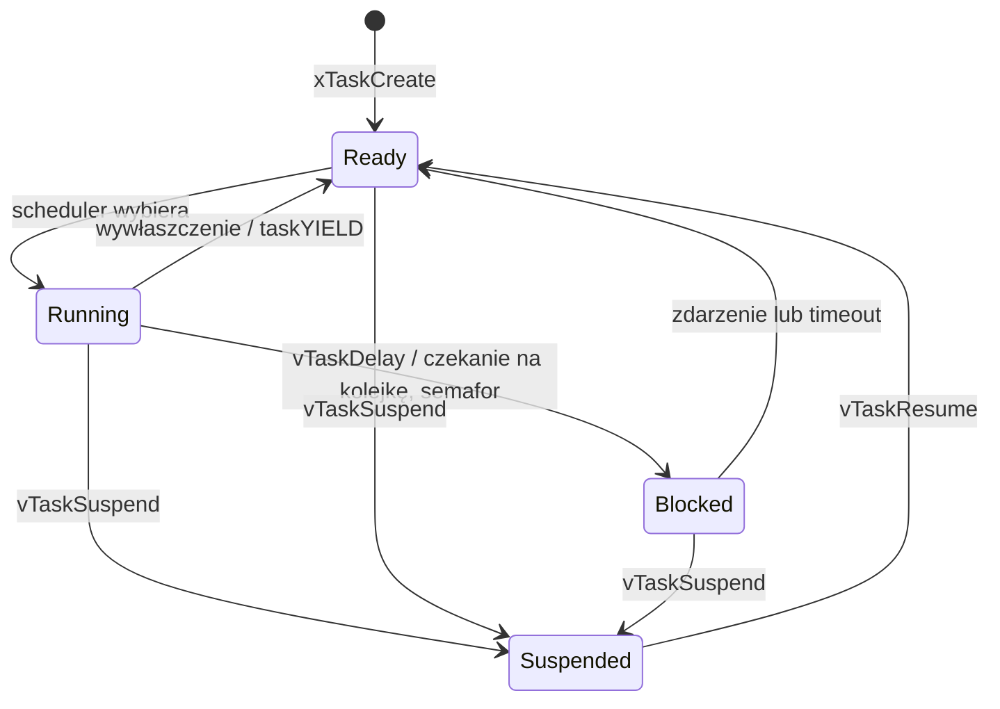

# Chapter 1: Podstawy RTOS i FreeRTOS

[← Spis treści](README.md)

**Cel rozdziału:** zbudować model mentalny: co robi scheduler, czym jest
zadanie, jak wygląda jego życie i dlaczego "wiele programów na jednym
rdzeniu" w ogóle działa.

---

## 1. Po co RTOS, skoro jest superloop?

Superloop (`while(1)` + flagi ustawiane w przerwaniach) działa dobrze,
dopóki system jest prosty. Problemy pojawiają się, gdy:

- jedno zadanie ma długą operację (np. zapis do flash) i **opóźnia**
  reakcję na inne zdarzenia,
- masz wiele niezależnych rytmów (czujnik co 10 ms, komunikacja co
  100 ms, UI co 33 ms) i ręcznie żonglujesz timerami/maszynami stanów,
- kod rośnie i trudno go rozdzielić na niezależne moduły.

RTOS pozwala pisać każdą aktywność jako **osobne zadanie** z własną
pętlą nieskończoną i własnym stosem, a scheduler decyduje, które z nich
dostaje CPU. Zyskujesz deterministyczną reakcję (zadanie o wyższym
priorytecie wywłaszcza niższe) i modularność – kosztem RAM (stos na
każde zadanie) i nowej klasy błędów (synchronizacja).

> RTOS **nie przyspiesza** programu. Daje przewidywalność i
> organizację. "Real-time" oznacza *gwarancję czasu reakcji*, nie
> szybkość.

## 2. Czym jest FreeRTOS

- Mały kernel (rzędu kilku KB Flash): zadania, kolejki, semafory,
  mutexy, timery programowe, event groups, task notifications,
  stream/message buffers.
- **Nie** jest systemem operacyjnym w sensie Linuksa: brak systemu
  plików, sieci, sterowników, pamięci wirtualnej (MMU), procesów. To
  tylko scheduler + prymitywy synchronizacji. Wszystkie zadania
  działają w jednej przestrzeni adresowej (są de facto wątkami).
- Licencja MIT, rozwijany przy wsparciu AWS. Popularny w STM32 (CubeMX),
  ESP32 (ESP-IDF), nRF, wielu SoC.

## 3. Podstawowe pojęcia

| Pojęcie | Znaczenie |
|---|---|
| **Task (zadanie)** | Funkcja z nieskończoną pętlą, własny stos, własny priorytet. Nigdy nie wolno jej zwrócić (`return`) – musi się usunąć przez `vTaskDelete(NULL)`. |
| **Scheduler** | Część kernela wybierająca, które zadanie w danej chwili się wykonuje. |
| **Tick** | Okresowe przerwanie timera (zwykle SysTick, typowo 1 kHz = 1 ms), które odmierza czas dla kernela (opóźnienia, timeouty). |
| **Context switch** | Zapamiętanie rejestrów bieżącego zadania i wczytanie rejestrów następnego. Na Cortex-M realizowane w przerwaniu `PendSV`. |
| **TCB** | *Task Control Block* – struktura kernela opisująca zadanie (wskaźnik stosu, priorytet, stan, nazwa). |
| **Idle task** | Zadanie tworzone automatycznie, o priorytecie 0; działa, gdy nic innego nie jest gotowe (sprząta usunięte zadania, może uśpić CPU). |

## 4. Algorytm szeregowania

FreeRTOS domyślnie używa **stałopriorytetowego, wywłaszczającego (preemptive)** schedulera:

1. Zawsze działa zadanie **o najwyższym priorytecie spośród gotowych**
   (Ready). Większa liczba = wyższy priorytet (0 = idle).
2. Gdy zadanie o wyższym priorytecie staje się gotowe (np. dostało
   dane z kolejki), **natychmiast wywłaszcza** niższe.
3. Zadania o **tym samym priorytecie** dzielą czas round-robin: zmiana
   co jeden tick (`configUSE_TIME_SLICING = 1`).

> Konsekwencja: zadanie wysokopriorytetowe, które nigdy się nie
> blokuje (aktywne czekanie w pętli), **zagłodzi** wszystkie niższe –
> w tym Idle task. Każde zadanie musi się regularnie blokować
> (opóźnienie, kolejka, semafor).

## 5. Stany zadania



| Stan | Opis |
|---|---|
| **Running** | Aktualnie wykonuje się na CPU (na jednym rdzeniu tylko jedno zadanie). |
| **Ready** | Gotowe, ale czeka, bo CPU ma zadanie o wyższym (lub równym) priorytecie. |
| **Blocked** | Czeka na zdarzenie lub upływ czasu (opóźnienie, kolejka, semafor, notyfikacja). **Nie zużywa CPU.** |
| **Suspended** | Jawnie wyłączone z szeregowania do `vTaskResume`. Rzadko używane. |

Zadanie w stanie **Blocked** z timeoutem wraca do Ready albo gdy
nadejdzie zdarzenie, albo gdy minie timeout – to podstawa projektowania
w RTOS: "czekaj na coś, ale nie dłużej niż X ms".

## 6. Co dzieje się przy przełączeniu kontekstu (Cortex-M)

1. Przerwanie SysTick (tick) lub wywołanie API kernela żąda przełączenia.
2. Kernel ustawia oczekujące przerwanie `PendSV` (o najniższym
   priorytecie), żeby przełączenie nie przerwało innego ISR.
3. W `PendSV` rejestry bieżącego zadania są zapisywane na **jego
   stosie**, wskaźnik stosu (PSP) trafia do TCB.
4. Scheduler wybiera następne zadanie, a jego rejestry są wczytywane
   z jego stosu. Powrót z przerwania "wraca" do innego zadania.

Dlatego **każde zadanie ma własny stos** i dlatego stos musi mieć miejsce
nie tylko na zmienne lokalne, ale też na zapisany kontekst (kilkadziesiąt
bajtów) oraz wywołania zagnieżdżone, w tym `printf`.

## 7. Pierwszy program

```c
#include "FreeRTOS.h"
#include "task.h"

static void vBlinkTask(void *pvParameters)
{
    (void)pvParameters;
    for (;;) {
        led_toggle();
        vTaskDelay(pdMS_TO_TICKS(500));   // zablokuj się na 500 ms - CPU wolne dla innych
    }
}

int main(void)
{
    hardware_init();
    xTaskCreate(vBlinkTask, "blink", 128, NULL, 1, NULL);
    vTaskStartScheduler();   // od tego momentu rządzi kernel; nie wraca (chyba że brak pamięci)
    for (;;) { }
}
```

`vTaskDelay` to nie aktywne czekanie: zadanie przechodzi do stanu
Blocked, a scheduler oddaje CPU innym. Porównaj to z `HAL_Delay()`,
który kręci się w pętli i marnuje procesor.

---

## ✅ Zadania

1. Narysuj własnymi słowami diagram stanów zadania i podaj po jednej
   funkcji API powodującej każde przejście.
2. Uruchom dwa zadania o tym samym priorytecie, każde mrugające inną
   diodą/wypisujące inny napis co 500 ms – co obserwujesz?
3. Ustaw jednemu z nich wyższy priorytet i zamiast `vTaskDelay` użyj
   pustej pętli `for(;;){}`. Co dzieje się z drugim zadaniem? Dlaczego?
4. Wyjaśnij, dlaczego `PendSV` ma najniższy priorytet przerwań.

**Notatki / odpowiedzi:**
```
(tu wpisz swoje wyniki)
```

---

**Następny rozdział:** [Chapter 2 – Konfiguracja](chapter2_configuration.md)
