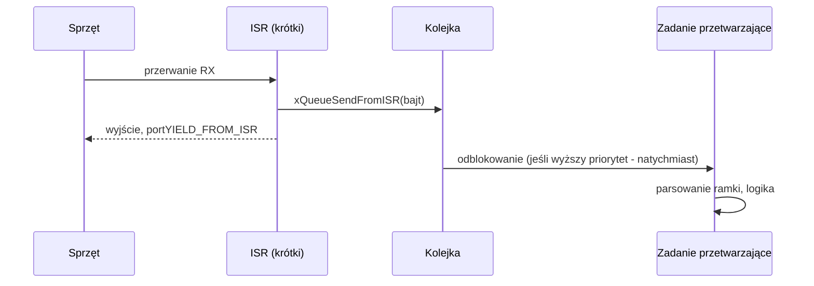

# Chapter 4: Kolejki i komunikacja z ISR

[← Spis treści](README.md)

**Cel rozdziału:** przekazywać dane między zadaniami i z przerwań w
sposób bezpieczny wątkowo, bez globalnych zmiennych i flag `volatile`.

---

## 1. Kolejka (queue) – podstawowy mechanizm komunikacji

Kolejka FIFO o stałej liczbie elementów stałego rozmiaru. Kluczowe cechy:

- **Kopiowanie przez wartość** – `xQueueSend` kopiuje element do bufora
  kolejki; nadawca może od razu zmodyfikować/zwolnić swoją zmienną.
- **Blokowanie z timeoutem** – odbiorca czeka na dane (stan Blocked, zero
  CPU), nadawca czeka na wolne miejsce.
- **Wielu nadawców i odbiorców** – bezpieczne wątkowo (kernel
  zabezpiecza dostęp).

```c
QueueHandle_t xQueueCreate(UBaseType_t uxQueueLength, UBaseType_t uxItemSize);
BaseType_t xQueueSend(QueueHandle_t q, const void *pItem, TickType_t xTicksToWait);
BaseType_t xQueueReceive(QueueHandle_t q, void *pBuffer, TickType_t xTicksToWait);
```

`xTicksToWait`:
- `0` – nie czekaj; zwróć od razu (`pdFAIL`/`errQUEUE_FULL` gdy pełna).
- `pdMS_TO_TICKS(n)` – czekaj do `n` ms.
- `portMAX_DELAY` – czekaj bez limitu (wymaga `INCLUDE_vTaskSuspend = 1`).

Funkcje zwracają `pdPASS`/`pdTRUE` przy sukcesie, `errQUEUE_FULL`/`pdFALSE`
przy timeoucie – **zawsze obsługuj wynik**.

## 2. Przykład: producent – konsument

```c
typedef struct {
    uint32_t timestamp_ms;
    int16_t  temperature_x10;     // 23.5 C -> 235
} SensorSample_t;

static QueueHandle_t xSampleQueue;

static void vSensorTask(void *arg)                 /* producent, okres 100 ms */
{
    TickType_t last = xTaskGetTickCount();
    for (;;) {
        SensorSample_t s = {
            .timestamp_ms    = xTaskGetTickCount() * portTICK_PERIOD_MS,
            .temperature_x10 = read_temperature_x10(),
        };
        if (xQueueSend(xSampleQueue, &s, 0) != pdPASS) {
            g_dropped_samples++;                    // konsument nie nadąża - nie blokuj czujnika
        }
        vTaskDelayUntil(&last, pdMS_TO_TICKS(100));
    }
}

static void vProcessTask(void *arg)                /* konsument, czeka na dane */
{
    SensorSample_t s;
    for (;;) {
        if (xQueueReceive(xSampleQueue, &s, portMAX_DELAY) == pdPASS) {
            filter_and_store(&s);
            mqtt_publish(&s);                       // może trwać długo - bufor kolejki to wygładzi
        }
    }
}

void app_start(void)
{
    xSampleQueue = xQueueCreate(8, sizeof(SensorSample_t));
    configASSERT(xSampleQueue != NULL);
    xTaskCreate(vSensorTask,  "sensor",  256, NULL, 3, NULL);
    xTaskCreate(vProcessTask, "process", 512, NULL, 2, NULL);
}
```
Dobór długości kolejki: musi wchłonąć **najgorszy chwilowy rozjazd**
szybkości producenta i konsumenta (np. gdy konsument zablokowany na
publikacji sieciowej 300 ms przy próbkowaniu co 100 ms – potrzeba >= 3-4 miejsc).

### Dane duże – przekazuj wskaźniki, ale z kontrolą własności

Kopiowanie 1 KB ramki przez kolejkę jest drogie. Wzorzec: kolejka
niesie **wskaźnik** do bufora z puli; nadawca po wysłaniu **nie dotyka**
bufora (przeniesienie własności), a odbiorca zwraca go do puli.

```c
typedef struct { uint8_t data[512]; size_t len; } Frame_t;
Frame_t *p = pool_alloc();
fill(p);
xQueueSend(xFrameQueue, &p, portMAX_DELAY);   // wysyłasz WSKAŹNIK (sizeof(Frame_t*))
// od tej chwili p należy do odbiorcy
```
Nie wysyłaj wskaźnika do zmiennej lokalnej nadawcy – zniknie ze stosu.

## 3. Przerwania i API `...FromISR`

W ISR **nie wolno** wołać zwykłych funkcji API – mogą blokować, a ISR
nie może się zablokować. Są dedykowane wersje z sufiksem `FromISR`
(nieblokujące):

| W zadaniu | W ISR |
|---|---|
| `xQueueSend` | `xQueueSendFromISR` |
| `xQueueReceive` | `xQueueReceiveFromISR` |
| `xSemaphoreGive` | `xSemaphoreGiveFromISR` |
| `xTaskNotifyGive` | `vTaskNotifyGiveFromISR` |
| `xEventGroupSetBits` | `xEventGroupSetBitsFromISR` |

Dodatkowo: ISR priorytet NVIC musi być **>= configMAX_SYSCALL_INTERRUPT_PRIORITY**
(patrz Chapter 2).

### Parametr `pxHigherPriorityTaskWoken` i `portYIELD_FROM_ISR`

Wyślesz dane z ISR → odblokujesz zadanie czekające na kolejkę. Jeśli to
zadanie ma **wyższy priorytet** niż to, które przerwano, powinno ruszyć
**natychmiast po wyjściu z ISR**, a nie dopiero przy następnym ticku.

```c
void USART2_IRQHandler(void)
{
    BaseType_t xHigherPriorityTaskWoken = pdFALSE;

    if (USART2->SR & USART_SR_RXNE) {
        uint8_t byte = (uint8_t)USART2->DR;                 // odczyt czyści flagę RXNE
        xQueueSendFromISR(xRxQueue, &byte, &xHigherPriorityTaskWoken);
    }

    portYIELD_FROM_ISR(xHigherPriorityTaskWoken);           // przełącz kontekst, jeśli trzeba
}
```
`xHigherPriorityTaskWoken` **musi** być zainicjowana na `pdFALSE`
(kernel tylko ustawia ją na `pdTRUE`, nigdy nie zeruje).

## 4. Deferred interrupt processing – złota zasada

> ISR ma robić **minimum**: obsłużyć sprzęt (wyczyść flagę, skopiuj
> bajt/DMA), przekazać zdarzenie do zadania i wyjść. Cała reszta
> (parsowanie, obliczenia, `printf`) należy do zadania.



Zalety: krótkie przerwania (niski jitter dla reszty systemu), pełny
dostęp do API w zadaniu (blokowanie, mutexy, `printf`), łatwiejsze
debugowanie. Ustaw zadaniu obsługi przerwania **wysoki priorytet**, jeśli
reakcja ma być szybka – nadal działa w kontrolowanym kontekście
zadania, nie przerwania.

## 5. Gatekeeper task – bezpieczny dostęp do wspólnego zasobu bez mutexa

Zamiast pozwalać wielu zadaniom pisać do UART/ekranu/I2C (i chronić to
mutexem), **jedno zadanie jest wyłącznym właścicielem zasobu**, a reszta
wysyła mu żądania przez kolejkę.

```c
typedef struct { char text[64]; } LogMsg_t;
static QueueHandle_t xLogQueue;

void log_print(const char *msg)                /* wołane z dowolnego zadania */
{
    LogMsg_t m;
    strncpy(m.text, msg, sizeof(m.text) - 1);
    m.text[sizeof(m.text) - 1] = '\0';
    xQueueSend(xLogQueue, &m, pdMS_TO_TICKS(10));
}

static void vLogTask(void *arg)                /* jedyny, który dotyka UART */
{
    LogMsg_t m;
    for (;;) {
        if (xQueueReceive(xLogQueue, &m, portMAX_DELAY) == pdPASS) {
            uart_write(m.text);
        }
    }
}
```
Zalety: brak deadlocków i priority inversion dla tego zasobu, łatwa
serializacja. Wada: dodatkowe zadanie i opóźnienie. Porównanie z
mutexem znajdziesz w Chapter 5.

## 6. Inne przydatne funkcje kolejek

```c
xQueueSendToBack / xQueueSendToFront   // dodanie na koniec (domyślne) lub początek
xQueuePeek(q, &item, ticks)             // odczyt BEZ usuwania z kolejki
uxQueueMessagesWaiting(q)               // ile elementów czeka
xQueueOverwrite(q, &item)               // kolejka długości 1 jako "ostatnia wartość" (np. odczyt czujnika)
xQueueReset(q)                          // wyczyść kolejkę
```

`xQueueOverwrite` na kolejce długości 1 to idealny wzorzec dla "ostatniej
znanej wartości", gdy konsumenta interesuje tylko najnowszy pomiar.

---

## ✅ Zadania

1. Zaimplementuj producenta (zadanie generujące liczby co 50 ms) i
   konsumenta (wypisującego je po 200 ms przetwarzania). Przy długości
   kolejki 2 policz, ile próbek tracisz; dobierz długość tak, by
   chwilowe rozjazdy się mieściły.
2. Odbieraj bajty z UART w ISR i wrzucaj do kolejki `xRxQueue`;
   w zadaniu składaj linię aż do `'\n'` i wypisuj ją w całości.
   Co się stanie, jeśli przez pomyłkę użyjesz `xQueueSend` zamiast
   `xQueueSendFromISR` w ISR (sprawdź z włączonym `configASSERT`)?
3. Zbuduj gatekeeper task logowania i wywołuj `log_print` z trzech
   zadań naraz – porównaj z wersją, gdzie każde zadanie samo woła
   `printf` (nałożone/poprzeplatane linie).
4. Wyjaśnij, po co `portYIELD_FROM_ISR` i co by się stało, gdyby go
   pominąć (kiedy zadanie by wystartowało?).

**Notatki / odpowiedzi:**
```
(tu wpisz swoje wyniki)
```

---

**Następny rozdział:** [Chapter 5 – Semafor vs Mutex](chapter5_semaphore_vs_mutex.md)
