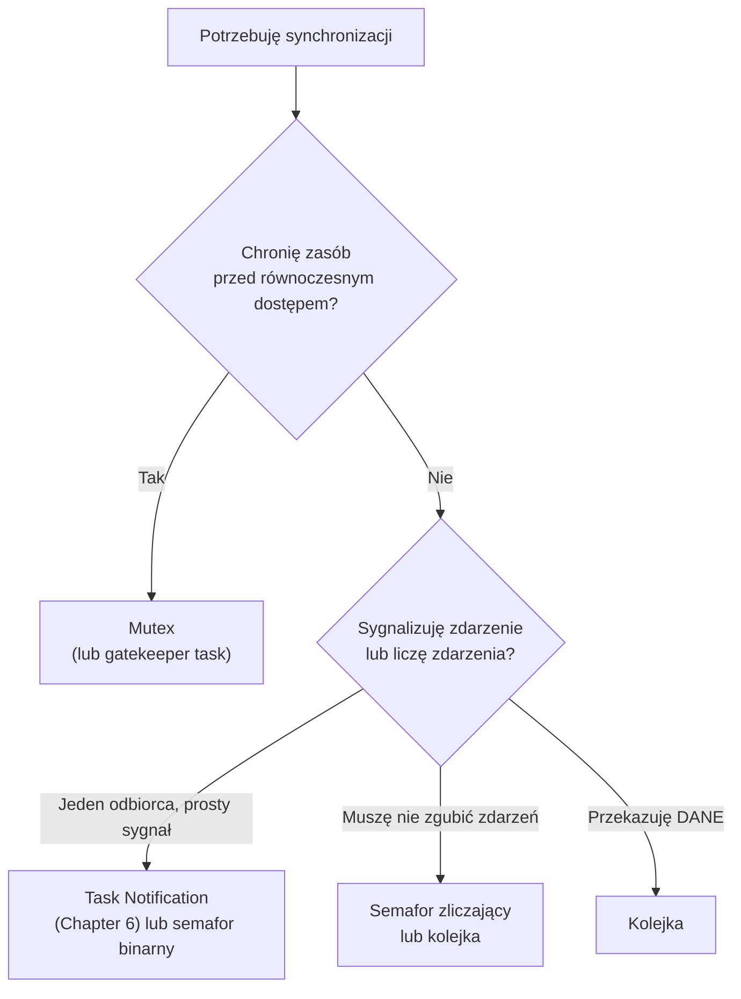

# Chapter 5: Semafor vs Mutex

[← Spis treści](README.md)

**Cel rozdziału:** zrozumieć, że semafor i mutex rozwiązują **dwa różne
problemy**, mimo że w FreeRTOS obsługuje się je tym samym API
(`xSemaphoreTake`/`xSemaphoreGive`). To klasyczne pytanie rekrutacyjne,
a pomyłka w wyborze jest źródłem trudnych do znalezienia błędów.

---

## 1. Dwa różne problemy

| Problem | Pytanie, które zadajesz | Narzędzie |
|---|---|---|
| **Sygnalizacja / synchronizacja** | "Zadanie B ma ruszyć dopiero, gdy A (lub ISR) coś zrobi/zgłosi." | **Semafor** (binarny/zliczający) |
| **Wzajemne wykluczanie** | "Tylko jedno zadanie naraz może używać tego zasobu (I2C, bufor, struktura)." | **Mutex** |

Intuicja:
- **Semafor = dzwonek/flaga zdarzenia.** Jeden daje sygnał, drugi na
  niego czeka. Nadawca i odbiorca to **różne** byty (często ISR → zadanie).
- **Mutex = klucz do toalety.** Kto weszedł (wziął), ten wychodzi
  (oddaje). Ten sam byt bierze i zwraca.

## 2. Semafor binarny – sygnalizacja zdarzenia

Ma dwa stany: "jest sygnał" / "brak sygnału". **Tworzony pusty** (brak sygnału):

```c
SemaphoreHandle_t xButtonSem = xSemaphoreCreateBinary();   // startuje jako "zajęty/pusty"
```

Typowy wzorzec: **ISR sygnalizuje zadaniu** (deferred interrupt processing):

```c
void EXTI0_IRQHandler(void)
{
    BaseType_t xWoken = pdFALSE;
    exti_clear_flag();
    xSemaphoreGiveFromISR(xButtonSem, &xWoken);     // "przycisk został wciśnięty"
    portYIELD_FROM_ISR(xWoken);
}

void vButtonTask(void *arg)
{
    for (;;) {
        if (xSemaphoreTake(xButtonSem, portMAX_DELAY) == pdTRUE) {   // śpi do sygnału
            vTaskDelay(pdMS_TO_TICKS(30));                            // debounce
            if (button_is_pressed()) {
                handle_button_press();
            }
        }
    }
}
```

Tu **ISR daje**, a **zadanie bierze** – dwie różne strony. Dokładnie to
semafor robi dobrze. Mutex byłby tu błędem (patrz sekcja 6).

Uwaga: binarny semafor **nie zlicza**. Jeśli ISR da sygnał trzy razy,
zanim zadanie zdąży go wziąć, zadanie zobaczy tylko **jeden** sygnał
(zdarzenia się "zlewają").

## 3. Semafor zliczający – liczenie zdarzeń lub zasobów

```c
SemaphoreHandle_t xCountSem = xSemaphoreCreateCounting(10 /*max*/, 0 /*początkowy*/);
```

**Zastosowanie A – liczenie zdarzeń (nie gub żadnego):**

```c
void TIM2_IRQHandler(void)                 // ISR: każde zdarzenie zwiększa licznik
{
    BaseType_t xWoken = pdFALSE;
    timer_clear_flag();
    xSemaphoreGiveFromISR(xCountSem, &xWoken);
    portYIELD_FROM_ISR(xWoken);
}

void vHandlerTask(void *arg)
{
    for (;;) {
        xSemaphoreTake(xCountSem, portMAX_DELAY);   // każde Take zmniejsza licznik o 1
        process_one_event();                         // 3 zdarzenia -> 3 obsługi
    }
}
```

**Zastosowanie B – pula zasobów:** semafor zainicjowany `N` oznacza "mam
N wolnych slotów". `Take` = zajmij slot (blokuje, gdy 0), `Give` =
zwolnij slot.

```c
#define NUM_DMA_CH 3
SemaphoreHandle_t xDmaPool = xSemaphoreCreateCounting(NUM_DMA_CH, NUM_DMA_CH);
```
Uwaga: semafor mówi **ile** slotów jest wolnych, ale nie **który**
konkretnie – wybór indeksu wymaga dodatkowej ochrony (np. mutex na
liście wolnych slotów).

## 4. Mutex – ochrona zasobu współdzielonego

**Tworzony w stanie "dostępny"** (inaczej niż semafor binarny):

```c
SemaphoreHandle_t xI2cMutex = xSemaphoreCreateMutex();
```

Przykład: magistrala I2C używana przez zadanie czujnika temperatury i
zadanie EEPROM. Transakcje nie mogą się przeplatać:

```c
int i2c_transfer_safe(uint8_t addr, uint8_t *buf, size_t len)
{
    if (xSemaphoreTake(xI2cMutex, pdMS_TO_TICKS(50)) != pdTRUE) {
        return -1;                          // timeout - ktoś trzyma magistralę za długo
    }

    int rc = hal_i2c_transfer(addr, buf, len);   // sekcja krytyczna: dostęp do zasobu

    xSemaphoreGive(xI2cMutex);              // ZAWSZE oddaj, na każdej ścieżce wyjścia
    return rc;
}
```

Zasady:
1. **Ten sam task bierze i oddaje.** (Z włączonym `configASSERT`,
   oddanie mutexa przez zadanie, które go nie trzyma, zostanie wykryte.)
2. **Trzymaj krótko.** Nie wołaj w sekcji krytycznej długich operacji,
   `vTaskDelay` ani czekania na inne obiekty, jeśli nie musisz.
3. **Nie używaj w ISR** (brak wersji `FromISR` – patrz niżej dlaczego).
4. **Zawsze używaj timeoutu** w kodzie produkcyjnym, zamiast
   `portMAX_DELAY` – ułatwia wykrycie zakleszczenia.

### RAII w C++ – nie zapomnisz oddać mutexa

```cpp
class MutexLock {
public:
    explicit MutexLock(SemaphoreHandle_t m, TickType_t timeout = portMAX_DELAY)
        : m_(m), locked_(xSemaphoreTake(m, timeout) == pdTRUE) {}
    ~MutexLock() { if (locked_) xSemaphoreGive(m_); }

    MutexLock(const MutexLock &) = delete;
    MutexLock &operator=(const MutexLock &) = delete;

    bool locked() const { return locked_; }

private:
    SemaphoreHandle_t m_;
    bool locked_;
};

int i2c_transfer_safe(uint8_t addr, uint8_t *buf, size_t len)
{
    MutexLock lock(xI2cMutex, pdMS_TO_TICKS(50));
    if (!lock.locked()) return -1;
    return hal_i2c_transfer(addr, buf, len);      // mutex zwolniony automatycznie przy wyjściu
}
```
To dokładnie wzorzec `std::lock_guard`, który znasz z C++ (RAII z kursu
rekrutacyjnego) – tylko dla mutexa FreeRTOS.

## 5. Priority inversion – dlaczego mutex jest "mądrzejszy"

**Priority inversion (inwersja priorytetów):** zadanie o wysokim
priorytecie jest *de facto* blokowane przez zadanie o średnim
priorytecie, bo to niskopriorytetowe, trzymające potrzebny zasób, nie
może się wykonać.

Trzy zadania: **H** (priorytet 3), **M** (2), **L** (1). H i L współdzielą zasób.

**Scenariusz bez priority inheritance (np. binarny semafor jako "zamek"):**

| Czas | Zdarzenie |
|---|---|
| t0 | L działa i **bierze** zasób. |
| t1 | H staje się gotowe, wywłaszcza L, próbuje wziąć zasób, **blokuje się** (czeka na L). |
| t2 | M staje się gotowe. H jest zablokowane, więc M (priorytet 2) **wywłaszcza L** (priorytet 1). |
| t3... | M działa długo. L nie dostaje CPU, więc nie oddaje zasobu. **H czeka na M** – mimo że H ma wyższy priorytet. |

Efekt: wysokopriorytetowe zadanie jest opóźniane przez zadanie o niższym
priorytecie przez czas **nieograniczony** (zależny od M). W 1997 roku
dokładnie ten błąd powodował samoistne restarty łazika *Mars Pathfinder*
(watchdog resetował system, bo zadanie wysokopriorytetowe nie dostawało
zasobu na czas).

**Ten sam scenariusz z mutexem (priority inheritance):**

| Czas | Zdarzenie |
|---|---|
| t0 | L bierze mutex. |
| t1 | H próbuje wziąć mutex i blokuje się. **Kernel podnosi priorytet L do 3** (dziedziczy po H). |
| t2 | M staje się gotowe, ale L ma teraz priorytet 3 > 2, więc **M nie wywłaszcza L**. |
| t3 | L kończy sekcję krytyczną i oddaje mutex, wraca do priorytetu 1. H bierze mutex i działa. M dostaje CPU dopiero później. |

Czas blokowania H jest ograniczony do czasu trwania sekcji krytycznej
L – a nie do czasu pracy M. To główny powód, dla którego **do ochrony
zasobu zawsze używasz mutexa, nie semafora binarnego**.

> FreeRTOS implementuje *basic* priority inheritance. Nie rozwiązuje
> wszystkiego (np. nie chroni przed deadlockiem z wieloma mutexami),
> ale eliminuje klasyczną inwersję.

## 6. Dlaczego mutex nie nadaje się do ISR

Dokumentacja FreeRTOS: mutexów **nie wolno używać z ISR**, ponieważ:
- mechanizm dziedziczenia priorytetów ma sens tylko dla zadań (ISR nie
  ma priorytetu zadania, który można podnosić),
- ISR **nie może się zablokować** w oczekiwaniu na zasób.

Dlatego nie ma `xSemaphoreTakeFromISR` dla mutexa. Do komunikacji
ISR ↔ zadanie używaj semafora, kolejki lub task notification.

## 7. Mutex rekurencyjny

Zwykły mutex wzięty dwa razy przez to samo zadanie zakleszcza je
(samo się zablokuje). Gdy funkcja chroniona mutexem woła inną funkcję
chronioną tym samym mutexem, użyj mutexa rekurencyjnego:

```c
SemaphoreHandle_t xRecMutex = xSemaphoreCreateRecursiveMutex();

xSemaphoreTakeRecursive(xRecMutex, portMAX_DELAY);   // 1. raz
xSemaphoreTakeRecursive(xRecMutex, portMAX_DELAY);   // 2. raz, to samo zadanie - OK
xSemaphoreGiveRecursive(xRecMutex);                   // oddaj tyle razy, ile wziąłeś
xSemaphoreGiveRecursive(xRecMutex);
```
Zwykle sygnał, że architektura wymaga uporządkowania (rozdziel
funkcję publiczną blokującą od wewnętrznej niezablokowanej), ale
bywa przydatny.

## 8. Deadlock – klasyczna pułapka z wieloma mutexami

```c
// Zadanie A                         // Zadanie B
Take(mutexX);                        Take(mutexY);
Take(mutexY);   // czeka na B        Take(mutexX);   // czeka na A  -> DEADLOCK
```
Zapobieganie:
- **Stała kolejność brania mutexów** w całym kodzie (zawsze X przed Y).
- Trzymaj jak najmniej mutexów jednocześnie.
- Używaj timeoutów i obsługuj ich przekroczenie.
- Rozważ gatekeeper task (Chapter 4) zamiast wielu mutexów.

## 9. Tabela porównawcza

| Cecha | Semafor binarny | Semafor zliczający | Mutex |
|---|---|---|---|
| **Cel** | Sygnalizacja zdarzenia | Liczenie zdarzeń / zasobów | Wzajemne wykluczanie |
| **Stan początkowy** | Pusty (brak sygnału) | Zadany (`initial`) | Dostępny |
| **Kto bierze/oddaje** | Różne byty (ISR → zadanie) | Różne byty | **Ten sam task** bierze i oddaje |
| **Priority inheritance** | Nie | Nie | **Tak** |
| **Użycie w ISR** | Tak (`GiveFromISR`) | Tak (`GiveFromISR`) | **Nie** |
| **Zlicza zdarzenia** | Nie (zlewa) | Tak (do `max`) | Nie dotyczy |
| **Typowy błąd użycia** | Użyty jako zamek na zasób → inwersja priorytetów | Zapomniany `Give` → wyczerpana pula | Oddany nie tym zadaniem / niezwolniony na jednej ścieżce → deadlock |

## 10. Praktyczna ściąga wyboru



Reguły kciuka:
- "**Mam zasób, do którego dostęp ma być po kolei**" → mutex.
- "**Coś się wydarzyło, ktoś ma na to zareagować**" → semafor / notification.
- "**Przekazuję wartość**" → kolejka (nie semafor + zmienna globalna).

## 11. Pełny przykład: czujnik + EEPROM na wspólnym I2C + przycisk z ISR

```c
static SemaphoreHandle_t xI2cMutex;     /* mutex: ochrona magistrali */
static SemaphoreHandle_t xButtonSem;    /* semafor binarny: ISR -> zadanie */

/* Zadanie 1: odczyt temperatury co 500 ms - używa I2C */
static void vTempTask(void *arg)
{
    TickType_t last = xTaskGetTickCount();
    for (;;) {
        uint8_t raw[2];
        if (i2c_read_safe(TEMP_ADDR, raw, 2) == 0) {
            update_temperature(raw);
        }
        vTaskDelayUntil(&last, pdMS_TO_TICKS(500));
    }
}

/* Zadanie 2: zapis konfiguracji do EEPROM po naciśnięciu przycisku - też używa I2C */
static void vEepromTask(void *arg)
{
    for (;;) {
        xSemaphoreTake(xButtonSem, portMAX_DELAY);      // semafor: czekam na zdarzenie
        i2c_write_safe(EEPROM_ADDR, config_blob, sizeof(config_blob));  // mutex wewnątrz
    }
}

/* ISR przycisku: tylko sygnał */
void EXTI0_IRQHandler(void)
{
    BaseType_t w = pdFALSE;
    exti_clear_flag();
    xSemaphoreGiveFromISR(xButtonSem, &w);
    portYIELD_FROM_ISR(w);
}

void app_start(void)
{
    xI2cMutex  = xSemaphoreCreateMutex();
    xButtonSem = xSemaphoreCreateBinary();
    configASSERT(xI2cMutex && xButtonSem);
    xTaskCreate(vTempTask,   "temp",   256, NULL, 2, NULL);
    xTaskCreate(vEepromTask, "eeprom", 256, NULL, 2, NULL);
}
```
Zwróć uwagę, że **w jednym programie występują oba mechanizmy do
różnych celów**: `xButtonSem` sygnalizuje zdarzenie z ISR, a `xI2cMutex`
chroni magistralę przed przeplataniem transakcji dwóch zadań.

---

## ✅ Zadania

1. Zaimplementuj scenariusz inwersji priorytetów z trzema zadaniami
   L/M/H, używając **binarnego semafora** jako zamka (utwórz go i daj
   raz na starcie). Zaobserwuj (diody/logi), że H czeka na M. Następnie
   zamień na `xSemaphoreCreateMutex()` i pokaż, że problem znika.
2. Napisz ISR przycisku + zadanie obsługi z **binarnym semaforem**,
   potem zastąp semafor **semaforem zliczającym** i wciskaj przycisk
   szybko wiele razy – porównaj, ile zdarzeń obsłużono.
3. Dodaj do swojego kodu klasę `MutexLock` (RAII) i użyj jej w dwóch
   zadaniach dzielących zasób (np. tablicę z licznikami). Sprowokuj
   wyścig danych bez mutexa i pokaż, że z mutexem znika.
4. Napisz kod z dwoma mutexami i **celowo wywołaj deadlock**, a potem
   napraw go przez stałą kolejność brania lub timeouty.
5. Odpowiedz bez zaglądania: dlaczego nie wolno użyć mutexa w ISR i co
   robi priority inheritance?

**Notatki / odpowiedzi:**
```
(tu wpisz swoje wyniki)
```

---

**Następny rozdział:** [Chapter 6 – Task notifications, Event Groups, Software Timers](chapter6_notifications_events_timers.md)
