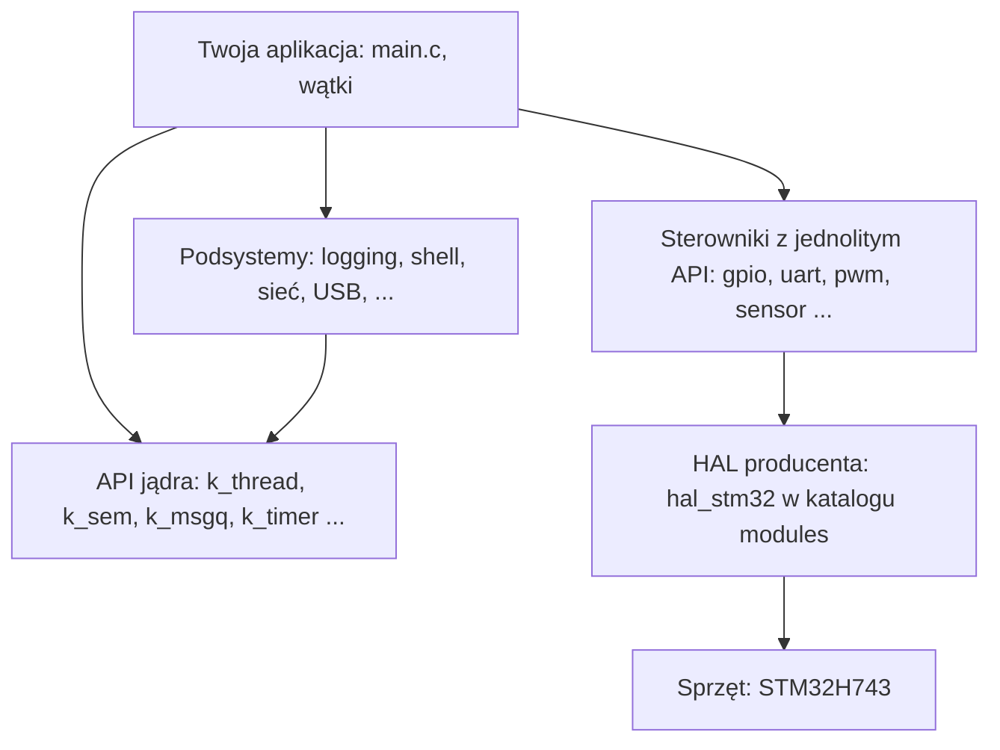
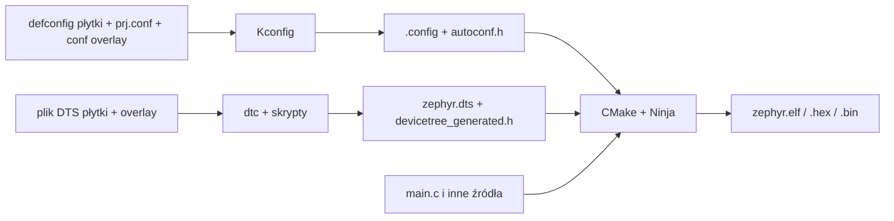

# Chapter 1: Architektura i system budowania

[← Spis treści](README.md)

**Cel rozdziału:** rozumieć, z czego składa się aplikacja Zephyra i skąd
bierze się plik wykonywalny: trzy filary (CMake, Kconfig, Devicetree), co
generuje system budowania i co dokładnie robi Twój blinky.

---

## 1. Warstwy Zephyra



Najważniejsza różnica względem „gołego” STM32 + HAL: **Ty nie wołasz HAL-a
ST**. Wołasz API Zephyra (`gpio_pin_toggle_dt`), a sterownik wewnątrz używa
`hal_stm32`. Dzięki temu ten sam `main.c` zbuduje się dla innej płytki, o ile
ma te same aliasy w drzewie urządzeń.

## 2. Trzy filary konfiguracji

| Filar | Odpowiada na pytanie | Pliki | Przykład |
|---|---|---|---|
| **CMake** | *Jak* zbudować? Jakie pliki? | `CMakeLists.txt` | `target_sources(app PRIVATE src/main.c)` |
| **Kconfig** | *Jakie funkcje* włączyć? | `prj.conf` | `CONFIG_GPIO=y` |
| **Devicetree** | *Jaki sprzęt* mamy i jak jest podłączony? | `.dts`, `.overlay` | `led0 = &green_led;` |

To kluczowe rozróżnienie. Gdy czegoś brakuje, pytasz siebie:
- **funkcja nie działa / brak symbolu przy linkowaniu** → zwykle Kconfig,
- **brak aliasu, błąd `DT_N_...`** → zwykle Devicetree,
- **brak pliku, zła lista źródeł** → CMake.

## 3. Jak z tego powstaje `zephyr.elf`



Kroki:
1. **Kconfig** scala konfigurację płytki, `prj.conf` i pliki dodatkowe do
   `.config`, a potem generuje `autoconf.h` z makrami `CONFIG_*`.
2. **Devicetree** scala plik płytki i overlaye do `zephyr.dts`, a potem
   generuje `devicetree_generated.h` z makrami `DT_*`.
3. **CMake/Ninja** kompiluje kod (z tymi nagłówkami), linkuje z jądrem i
   sterownikami, a w efekcie powstaje `zephyr.elf`.

Dzięki temu **kod jest dopasowany do konfiguracji w czasie kompilacji**:
sterownik, który nie jest włączony w Kconfig albo w DT, po prostu nie trafi
do pliku wynikowego.

## 4. Struktura aplikacji

Minimalna aplikacja (taka jak `moja_apka`):

```
moja_apka/
├── CMakeLists.txt        <- opis budowania
├── prj.conf              <- opcje Kconfig
├── src/main.c            <- kod
└── boards/               <- (opcjonalnie) pliki dla konkretnych płytek
    └── nucleo_h743zi.overlay   <- ten plik byłby użyty automatycznie
```

`CMakeLists.txt` blinky:

```cmake
cmake_minimum_required(VERSION 3.28.0)
find_package(Zephyr REQUIRED HINTS $ENV{ZEPHYR_BASE})
project(blinky)

target_sources(app PRIVATE src/main.c)
```

- `find_package(Zephyr ...)` wciąga cały system budowania Zephyra,
- `app` to predefiniowany target Twojego kodu,
- **nie ma** `add_executable` ani listy sterowników. Zephyr dołącza je na
  podstawie Kconfig i Devicetree.

`prj.conf` blinky ma jedną linię:

```
CONFIG_GPIO=y
```

## 5. Twój blinky linia po linii

```c
#include <stdio.h>
#include <zephyr/kernel.h>
#include <zephyr/drivers/gpio.h>

#define SLEEP_TIME_MS   1000

#define LED0_NODE DT_ALIAS(led0)
#define LED1_NODE DT_ALIAS(led1)

static const struct gpio_dt_spec led  = GPIO_DT_SPEC_GET(LED0_NODE, gpios);
static const struct gpio_dt_spec led1 = GPIO_DT_SPEC_GET(LED1_NODE, gpios);

int main(void)
{
	int ret;
	bool led_state = true;

	if (!gpio_is_ready_dt(&led) || !gpio_is_ready_dt(&led1)) {
		return 0;
	}

	ret = gpio_pin_configure_dt(&led, GPIO_OUTPUT_ACTIVE);
	...
	while (1) {
		ret = gpio_pin_toggle_dt(&led);
		...
		printf("LED state: %s\n", led_state ? "ON" : "OFF");
		k_msleep(SLEEP_TIME_MS);
	}
}
```

| Fragment | Co robi |
|---|---|
| `DT_ALIAS(led0)` | Makro z `devicetree_generated.h`: identyfikator węzła, na który wskazuje alias `led0` w DTS płytki. Dla Twojej płytki to LD1 (zielona dioda, PB0). |
| `GPIO_DT_SPEC_GET(node, gpios)` | Tworzy stałą strukturę `gpio_dt_spec`: **kontroler GPIO + numer pinu + flagi** (np. aktywny stan wysoki), wszystko znane w czasie kompilacji. |
| `gpio_is_ready_dt(&led)` | Sprawdza, czy sterownik GPIO jest zainicjowany. **Zawsze** sprawdzaj gotowość urządzeń. |
| `gpio_pin_configure_dt(&led, GPIO_OUTPUT_ACTIVE)` | Konfiguruje pin jako wyjście i ustawia stan *aktywny* (dioda świeci). Flaga `GPIO_ACTIVE_HIGH`/`LOW` z DTS jest uwzględniana automatycznie. |
| `gpio_pin_toggle_dt` | Przełącza stan. |
| `printf` | Działa dzięki `CONFIG_UART_CONSOLE=y` (w defconfig płytki) i bibliotece picolibc. |
| `k_msleep(1000)` | Usypia **wątek** `main` na 1 s. Procesor jest wtedy oddany innym wątkom lub *idle*. |

Zwróć uwagę na dwie rzeczy:
- **żaden numer pinu nie występuje w kodzie.** Wszystko pochodzi z DTS płytki,
  więc ten sam kod zadziała na płytce, gdzie LED jest na innym pinie,
- **nie ma inicjalizacji zegarów, GPIO, SysTicka**. Zrobił to kernel i sterowniki
  przed `main()`.

## 6. `main()` to wątek

Zephyr nie wymaga wywołania `vTaskStartScheduler()`. Kolejność jest taka:

1. reset → inicjalizacja rdzenia i zegarów,
2. sterowniki i podsystemy startują w poziomach: `PRE_KERNEL_1` →
   `PRE_KERNEL_2` → `POST_KERNEL` → `APPLICATION`,
3. kernel tworzy **wątek `main`** (domyślnie priorytet 0, stos 1024 B) i
   uruchamia funkcję `main()` oraz wątek *idle*.

Dla Twojej płytki te wartości z `.config` to:

```
CONFIG_MAIN_STACK_SIZE=1024
CONFIG_MAIN_THREAD_PRIORITY=0
CONFIG_IDLE_STACK_SIZE=320
CONFIG_ISR_STACK_SIZE=2048
```

Co ciekawe, `main()` **może się zakończyć** (`return 0`). Wątek `main`
po prostu znika, a reszta systemu (inne wątki, timery, shell) działa dalej.
W praktyce widać to na liście wątków w Chapter 8.

## 🔧 Różnica względem STM32 + CubeMX + FreeRTOS

| STM32 + CubeMX + FreeRTOS | Zephyr |
|---|---|
| Generator kodu produkuje `MX_GPIO_Init()` itd. | Brak generatora, sprzęt opisany deklaratywnie w DT |
| Piny i zegary w pliku `.ioc` | Piny (`pinctrl`) i zegary w DTS / overlay |
| `FreeRTOSConfig.h` z makrami | `prj.conf` z typowanymi symbolami Kconfig |
| Wywołujesz `HAL_GPIO_...` | Wołasz `gpio_...`, sterownik używa HAL-a |
| `vTaskStartScheduler()` | Scheduler działa od startu, `main()` jest wątkiem |
| Zmiana płytki = nowy projekt CubeMX | Zmiana płytki = inna wartość `-b`, o ile aliasy się zgadzają |

---

## ✅ Zadania

1. Otwórz `build\blinky\zephyr\.config` i znajdź `CONFIG_GPIO`,
   `CONFIG_MAIN_STACK_SIZE`, `CONFIG_SYS_CLOCK_TICKS_PER_SEC`. Co wynika z
   ostatniej wartości (rozdzielczość `k_msleep`)?
2. Otwórz `zephyr.dts` i znajdź węzeł z aliasem `led0`. Na jaki pin
   wskazuje i jaka jest polaryzacja?
3. Otwórz `devicetree_generated.h` i wyszukaj `led0`. Zobacz, jak alias
   zamienił się w makra.
4. Dodaj do `prj.conf` linię `CONFIG_GPIOO=y` (literówka) i zbuduj.
   Zapisz komunikat błędu – wrócimy do niego w Chapter 3.
5. Wyjaśnij własnymi słowami, dlaczego w `main.c` nie ma żadnego numeru pinu.

**Notatki / odpowiedzi:**
```
(tu wpisz swoje wyniki)
```

---

**Następny rozdział:** [Chapter 2 – Devicetree](chapter2_devicetree.md)
